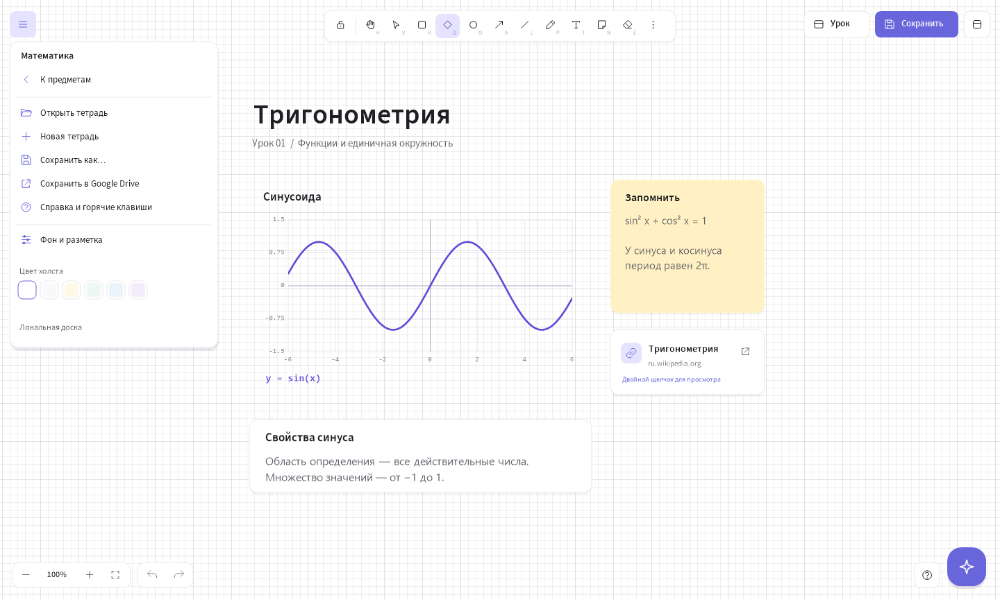
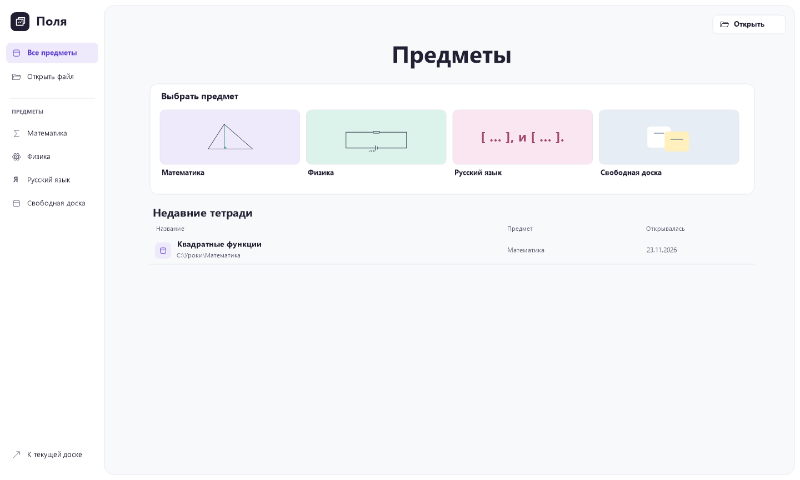
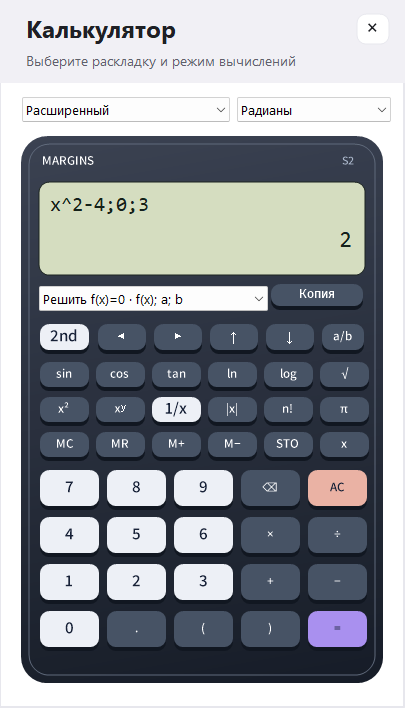

# Margins

**Учебная доска для Windows.** Margins объединяет рисование от руки, конспекты и интерактивные материалы для уроков и самостоятельной работы. Тетради можно распределять по математике, физике, русскому языку и другим предметам. Доски и редактируемые объекты сохраняются в локальном файле `.polya`.

## Скачать

Откройте [последний релиз](../../releases/latest), скачайте архив для Windows x64 и распакуйте его целиком. Запустите `Margins.exe`. Для просмотра сайтов внутри доски нужен [Microsoft Edge WebView2 Runtime](https://developer.microsoft.com/microsoft-edge/webview2/).

## Возможности

- **Рисование и конспекты.** Перо с нажимом через Windows Ink, фигуры, текст без карточек, заметки, изображения, ластик объектов и пиксельный ластик.
- **Математика.** Графики функций с параметром, тригонометрическая окружность с подвижной точкой, редактируемые чертежи по планиметрии и стереометрии.
- **Физика.** Схемы цепей постоянного тока с редактируемыми компонентами и ветвями, справочник физических постоянных и инженерный калькулятор.
- **Встроенный браузер.** Вставьте адрес через `Ctrl+V`. Страницу можно закрепить на холсте, менять её размер и рисовать поверх живого сайта. При зуме браузер и пометки масштабируются вместе с доской.
- **Уроки.** Собирайте материал в кадры, запускайте показ через `F5`, раскрывайте ответы на задания и следите за временем с помощью таймера.

## Скриншоты



| Библиотека тетрадей | Редактор электрической цепи |
| --- | --- |
|  |  |



## Файлы и синхронизация

`Ctrl+S` сохраняет тетрадь, `Ctrl+O` открывает её. Margins автоматически создаёт локальные копии тетрадей. Для облачного сохранения выберите в меню доски папку, которую синхронизирует Google Диск для компьютеров. После настройки `Ctrl+Shift+D` записывает туда текущую тетрадь. Автосохранение в эту папку можно включить отдельно. [Инструкция Google](https://support.google.com/drive/answer/10838124?hl=ru)

## Сборка из исходников

Приложение написано на C# с использованием WinForms и .NET Framework. Выполните команду из корня репозитория в Windows:

```powershell
powershell -NoProfile -ExecutionPolicy Bypass -File .\src\build.ps1
```

Сборка создаёт `src\Polya.exe` для Windows x64. Скрипт скачивает указанную версию SDK WebView2 и копирует библиотеки рядом с программой.

## Лицензия

Исходный код открыт под [лицензией MIT](LICENSE). Шрифты Assistant и Source Sans 3 распространяются под лицензиями SIL Open Font License, включёнными в [папку исходников](src).

## Рекомендации

- Сохраняйте копию тетради перед большой переработкой урока.
- Для совместимого графического планшета включите Windows Ink в настройках драйвера.
- Если доска тормозит, приложите к отчёту версию Windows, масштаб дисплея и небольшой файл `.polya`, на котором воспроизводится проблема.
