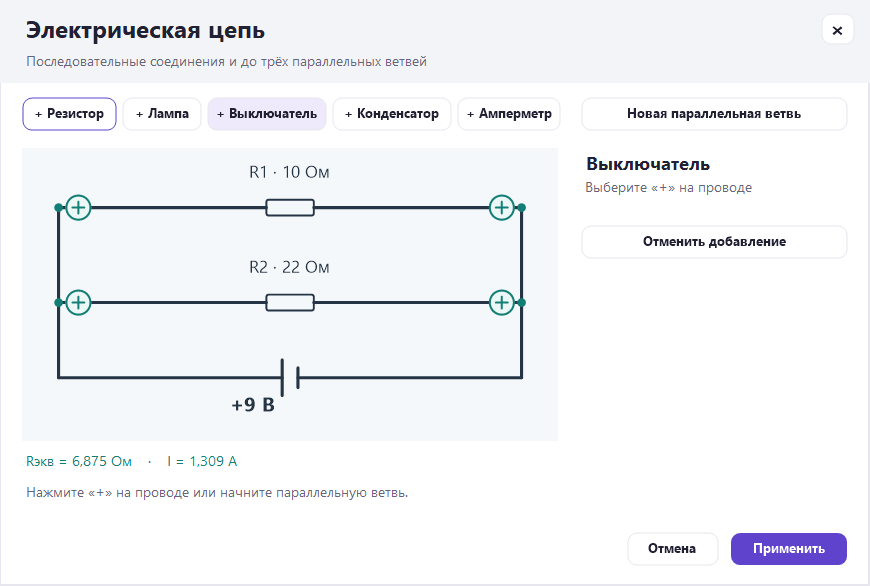

# Margins

**An offline whiteboard for lessons, tutoring, and study on Windows.**

Margins brings freehand drawing, notes, and subject-specific teaching tools into one workspace. Create a notebook for mathematics, physics, Russian language, or general work. Save it as a local `.polya` file and reopen it with its boards and editable objects intact.

## Download

Download **`Polya-v8.exe`** from [Releases](../../releases/latest) and run it on Windows. The v8 executable uses the original name **Поля** and has a Russian-language interface.

## What you can do

- **Sketch and annotate.** Draw with a pen, add shapes, notes and links, import PNG or JPEG worksheets, and erase objects by sweeping across them. Snap hand-drawn circles and straight strokes into clean shapes.
- **Teach mathematics.** Plot functions, vary a parameter live, explore the unit circle, and drag vertices in geometry diagrams. Measurements and dependent constructions update as points move.
- **Teach physics.** Build and edit simple DC circuits by inserting components onto wires. Change resistance, source voltage, branches, and switch states. The editor displays equivalent resistance and current for its idealized DC model.
- **Run a lesson.** Organize material into frames, present it with `F5`, reveal answers, and display a countdown timer. The library includes subject-specific reference cards and lesson templates.
- **Work with larger boards.** The canvas reuses rendered regions, updates the active gesture separately, and keeps grid lines anchored during zoom.

## Screenshots


| Notebook library | Editable circuit |
| --- | --- |
|  |  |

## Files and sync

Use `Ctrl+S` to save a notebook and `Ctrl+O` to open one. To sync a notebook through Google Drive, save it inside a folder managed by Google Drive for desktop. [Google Drive for desktop guide](https://support.google.com/drive/answer/10838124)

## Build from source

Margins is written in C# using WinForms and the .NET Framework. On Windows, run the build script from the repository root:

```powershell
powershell -NoProfile -ExecutionPolicy Bypass -File .\src\build.ps1
```

The build produces `src\Polya.exe`. The UI fonts are embedded in the executable.

## License

The application source is available under the [MIT License](LICENSE). Assistant and Source Sans 3 are distributed under their respective SIL Open Font Licenses, included in [the source folder](src).

## Recommendations

- Keep a dated `.polya` copy before making large changes to a lesson notebook.
- Use frames to divide long lessons into a short explanation, a worked example, and practice. In presentation mode, use the arrow keys to switch frames and `Enter` to reveal an answer.
- For performance reports, include the Windows version, display scaling, and the slow action, such as panning, zooming, drawing, or opening a file. A small notebook without personal or student information is especially useful for reproducing the issue.
